# Task 2 — measured results

Project: `23L-0630_A2_Ops`. Started: 2026-10-24T21:17:39.119258+05:00.
TensorFlow 2.21.0; Keras 3.15.1; Keras Tuner 1.4.8.
Initial training source commit: `8c6c3bf0a3793646fe182875613722270385b6a1`. Evaluation source commit:
`2b9fb8c8c1ca6ec7d25782d8de0a564e8baf8581`. See `resume_config.json` for the resumed-stage revision.

These are actual local experiment outputs, not MLflow/DagsHub evidence. Full
methods, layer justifications and screenshot instructions are in
`../../docs/TASK2_GUIDE.md`. Raw image provenance has not been independently verified.

## 2.1 — fixed splits and augmentation

One extra exact duplicate was excluded without deleting original files. The split
uses seed 42 and has no overlapping exact content hashes.

| split | Real | AI | total |
| --- | --- | --- | --- |
| train | 305 | 376 | 681 |
| validation | 65 | 81 | 146 |
| test | 66 | 81 | 147 |

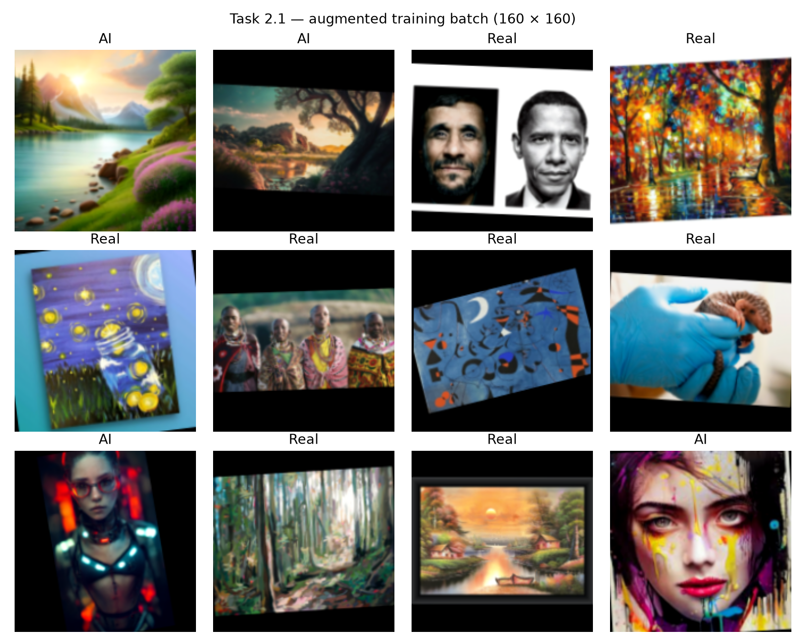

Figure: 160 × 160 RGB training samples after padding and random augmentation.
Validation and test images receive no random transformations. See the guide for
the decoding, caching, batching and prefetching explanation.

## 2.2 — baseline architecture

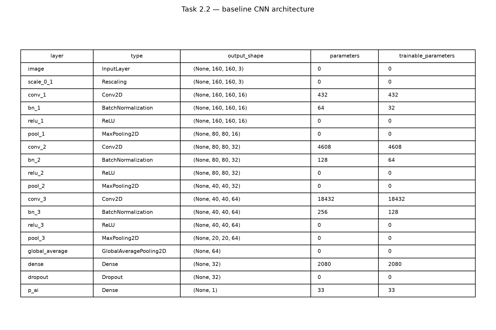

Figure: three convolution/normalization/ReLU/pooling blocks followed by global
average pooling, a 32-unit dense layer, dropout and one sigmoid output. Exact
layer counts are also in `summaries/baseline_layers.csv` and `summaries/baseline.txt`.

## 2.3 and 2.4 — training stages and best epochs

| stage | best_epoch | epochs_run | best_validation_loss | seconds |
| --- | --- | --- | --- | --- |
| baseline | 17 | 20 | 0.64323 | 154.28 |
| transfer_frozen | 12 | 12 | 0.52886 | 108.67 |
| transfer_last_block | 11 | 12 | 0.49106 | 115.91 |

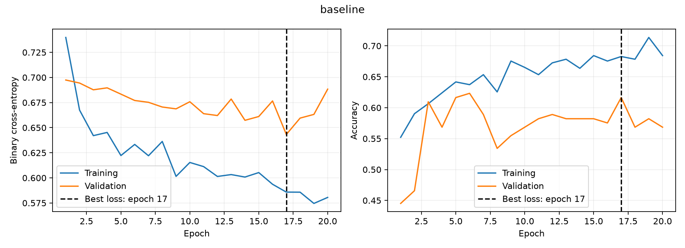
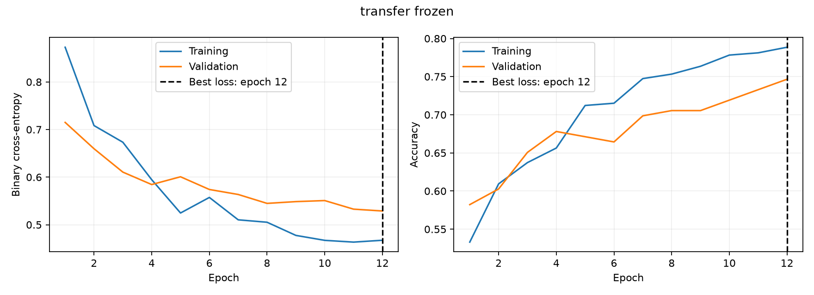
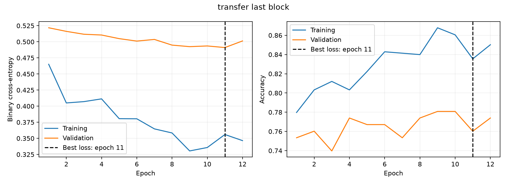

Figures: training and validation loss/accuracy for each stage. Dashed lines mark
minimum validation-loss epochs. Checkpoints restore those epochs, not necessarily
the final epoch. Accuracy during training uses threshold 0.5; the final evaluation
uses the validation-selected thresholds below.

Layers with trainable parameters (the full lists also include frozen layers):

- **transfer_frozen:** p_ai.
- **transfer_last_block:** block_16_expand, block_16_depthwise, block_16_project, Conv_1, p_ai.
- **transfer_tuned:** block_16_depthwise, block_16_project, Conv_1, p_ai.

Transfer candidate selected before testing: **tuned**.
Candidate minimum validation losses: `{'frozen_head': 0.5288604497909546, 'last_block': 0.4910646080970764, 'tuned': 0.4539927542209625}`.
The best tuner trial's checkpoint is from epoch **5**.

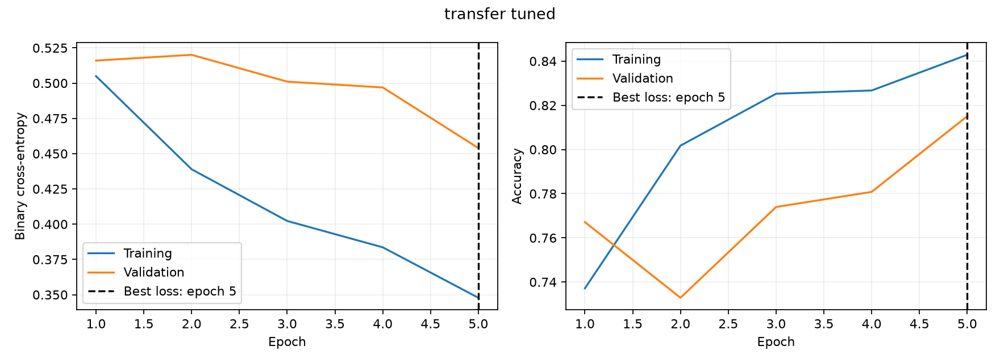

Figure: training and validation curves for the winning tuning trial. The minimum
validation-loss epoch supplies its saved weights; no extra retraining or test-based
configuration change was performed.

## 2.5 — threshold selection and one held-out evaluation

Validation results used for decisions:

| model | threshold | accuracy | f1 | roc_auc | weighted_error |
| --- | --- | --- | --- | --- | --- |
| baseline | 0.69134 | 0.60959 | 0.49558 | 0.69801 | 61.0 |
| transfer | 0.53836 | 0.82192 | 0.83117 | 0.86971 | 35.0 |

AI is positive. Thresholds minimize `2 FP + FN` on validation images; a false
accusation of AI is assigned twice the cost of missing an AI image. This is a
declared product choice, not a measured harm ratio. Ties prefer higher F1 and then
a threshold nearer 0.5. **transfer** was chosen using validation cost
and validation ROC-AUC, before looking at test results.

Test metrics on 147 previously held-out images:

| model | threshold | accuracy | precision | recall | f1 | roc_auc | fp | fn |
| --- | --- | --- | --- | --- | --- | --- | --- | --- |
| baseline | 0.69134 | 0.61905 | 0.87879 | 0.35802 | 0.50877 | 0.7428 | 4 | 52 |
| transfer | 0.53836 | 0.81633 | 0.84615 | 0.81481 | 0.83019 | 0.86794 | 12 | 15 |

The transfer model correctly classifies 120
of 147 test images, compared with 91 for the CNN.
Its weighted test error is 39, versus
60 for the CNN. The baseline makes fewer false AI
accusations (4 versus 12), but misses
many more AI images (52 versus 15).
This shows why its relatively high precision does not imply strong overall
detection. The model choice was already fixed on validation data before this
comparison was observed.

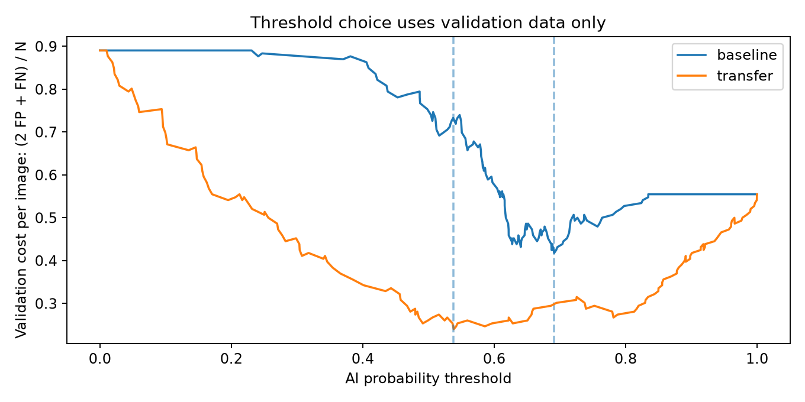
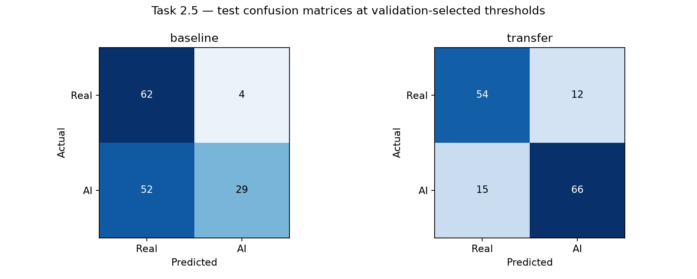
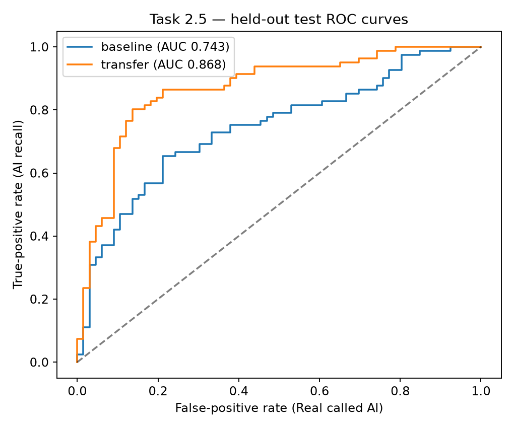

Figures: validation-only threshold costs, test confusion matrices (Real then AI),
and test ROC curves. All test measures come from one saved prediction pass per
final model. Precision/recall/F1 refer to the AI class. Scores are uncalibrated;
neither model should be presented as reliable proof of an image's origin.

## 2.6 — error analysis

The following are the most confident wrong test predictions. Their selection
highlights failure modes rather than estimating their prevalence. Each explanation
is a hypothesis from visual inspection; it does not establish the model's causal
reason for predicting that label.

### baseline: 10 errors

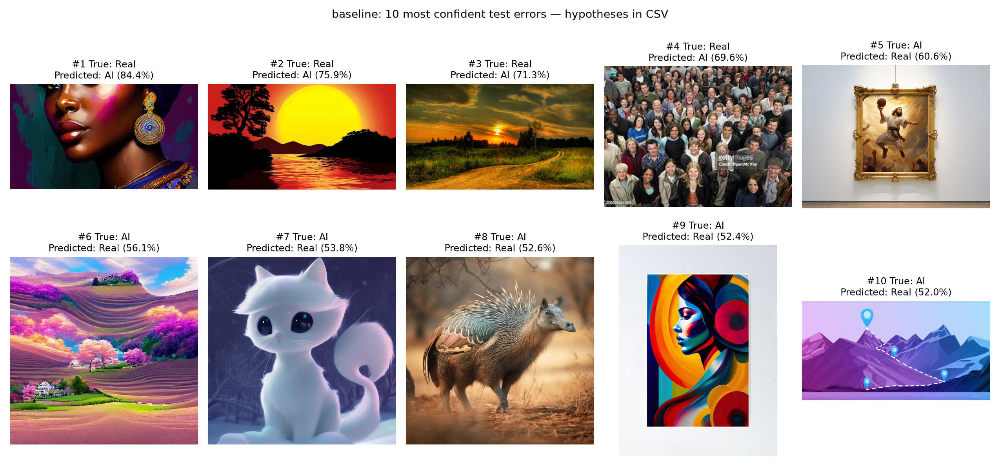

| figure_id | path | class | predicted_label | confidence | hypothesis |
| --- | --- | --- | --- | --- | --- |
| 1 | RealArt/RealArt/images108.jpg | Real | AI | 84.4% | Saturated paint and glossy facial highlights may match coarse colour and texture patterns associated with AI examples. |
| 2 | RealArt/RealArt/51sGagaZbS._AC_UF10001000_QL80_.jpg | Real | AI | 75.9% | The large flat sun and black silhouettes resemble a digital illustration, a style that overlaps with AI-labelled artwork. |
| 3 | RealArt/RealArt/beautiful-scenery-wallpaper_1920x1080_91975.jpg | Real | AI | 71.3% | The strongly saturated golden sunset may trigger a colour-based shortcut even though the dataset labels this scene Real. |
| 4 | RealArt/RealArt/image16.jpeg | Real | AI | 69.6% | The crowded, compressed group photograph contains many tiny faces and visible watermark text; downsampling can obscure natural photographic detail. |
| 5 | AiArtData/AiArtData/jesus-dunking-scaled.jpg | AI | Real | 60.6% | The generated subject is presented as a framed artwork on a gallery wall; the frame and surrounding room may supply convincing photographic context. |
| 6 | AiArtData/AiArtData/2A8oNV0baUgW9iGIEk1X.jpg | AI | Real | 56.1% | The pink and purple terraced landscape has a familiar field layout; a small CNN may miss the implausible colours and repeated terrain patterns. |
| 7 | AiArtData/AiArtData/1ayKvyXsQfIHS7OOCswZA1g.png | AI | Real | 53.8% | The smooth white cartoon cat resembles conventional illustration, so stylization alone cannot distinguish AI generation from human-made artwork. |
| 8 | AiArtData/AiArtData/ai-generated-animal-crossbreeds-09.jpg | AI | Real | 52.6% | The hybrid animal has a natural-looking brown background and lighting; resizing may conceal the anatomical inconsistencies that could distinguish it. |
| 9 | AiArtData/AiArtData/fpostersmallwall_textureproduct750x1000.u2.jpg | AI | Real | 52.4% | The colourful profile is displayed like a physical art print, potentially making its presentation resemble Real artwork examples. |
| 10 | AiArtData/AiArtData/tsia-navigating-ai-landscape-blog-hero.png | AI | Real | 52.0% | The geometric map graphic resembles conventional vector art; the CNN may learn broad subject/style cues rather than generation-specific evidence. |
### transfer: 10 errors

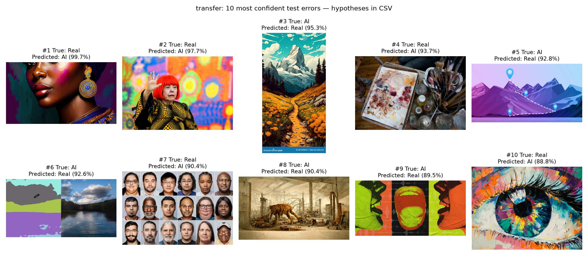

| figure_id | path | class | predicted_label | confidence | hypothesis |
| --- | --- | --- | --- | --- | --- |
| 1 | RealArt/RealArt/images108.jpg | Real | AI | 99.7% | The painted face has saturated colours and glossy highlights; these may resemble generated portraits despite its Real folder label. |
| 2 | RealArt/RealArt/231019-Yayoi-Kusama-ew-337p-647c5e.jpg | Real | AI | 97.7% | The bright red wig and highly colourful mural create an unusual photographic scene that may resemble synthetic imagery. |
| 3 | AiArtData/AiArtData/ath-flowers-vivid-colors-generative-ai-landscape-painting-mountain-281590810.jpg | AI | Real | 95.3% | The AI-labelled mountain illustration resembles a conventional travel poster; the stock watermark and drawn textures may provide misleading familiar cues. |
| 4 | RealArt/RealArt/_MG_5812.jpg | Real | AI | 93.7% | The close-up of a paint palette and brushes contains irregular colour patches and clutter that may be confused with generated textures. |
| 5 | AiArtData/AiArtData/tsia-navigating-ai-landscape-blog-hero.png | AI | Real | 92.8% | The flat geometric mountain graphic resembles ordinary vector design, which also occurs among the Real class's non-photographic images. |
| 6 | AiArtData/AiArtData/nvidia-ai-scribbles-realistic-landscapes.png | AI | Real | 92.6% | The side-by-side segmentation map and realistic lake scene may let the photographic half or unusual composite layout dominate the decision. |
| 7 | RealArt/RealArt/images70.jpg | Real | AI | 90.4% | Many small headshots are combined in a grid; resizing may remove facial detail, while the repeated portrait layout resembles synthetic face collections. |
| 8 | AiArtData/AiArtData/tiger4.jpg | AI | Real | 90.4% | The sepia tiger-and-machinery illustration resembles traditional concept art, making artistic style an unreliable origin cue. |
| 9 | AiArtData/AiArtData/240201-airec-main-ksp-5625e8.jpg | AI | Real | 89.5% | The mouths use flat pop-art colours and repeated outlines, which overlap with poster and illustration styles in the Real class. |
| 10 | RealArt/RealArt/360_F_273227473_N0WRQuX3uZCJJxlHKYZF44uaJAkh2xLG.jpg | Real | AI | 88.8% | The painted eye has strong brush textures and saturated colour blocks that may resemble generated artwork; painted style does not determine origin. |

## 2.7 — Keras Tuner

Toy search: four combinations, three epochs maximum per trial, 10,000 training and
2,000 validation Fashion-MNIST images. Best settings:
`{'units': 64, 'learning_rate': 0.001}`.

| trial_id | status | units | learning_rate | best_val_loss | best_step_zero_based |
| --- | --- | --- | --- | --- | --- |
| 0 | COMPLETED | 64 | 0.001 | 0.483745 | 2 |
| 1 | COMPLETED | 32 | 0.001 | 0.522552 | 2 |
| 2 | COMPLETED | 64 | 0.0003 | 0.56764 | 2 |
| 3 | COMPLETED | 32 | 0.0003 | 0.613507 | 2 |

VisionGuard: all eight combinations, up to five epochs each, selecting minimum
validation loss. Best settings:
`{'learning_rate': 0.0001, 'dropout': 0.5, 'unfrozen_layers': 8}`.

| trial_id | status | learning_rate | dropout | unfrozen_layers | best_val_loss | best_step_zero_based |
| --- | --- | --- | --- | --- | --- | --- |
| 7 | COMPLETED | 0.0001 | 0.5 | 8 | 0.453993 | 4 |
| 0 | COMPLETED | 0.0001 | 0.2 | 4 | 0.472424 | 3 |
| 3 | COMPLETED | 0.0001 | 0.2 | 8 | 0.475881 | 4 |
| 6 | COMPLETED | 0.0001 | 0.5 | 4 | 0.486083 | 4 |
| 4 | COMPLETED | 1e-05 | 0.2 | 8 | 0.513859 | 4 |
| 2 | COMPLETED | 1e-05 | 0.5 | 8 | 0.516032 | 4 |
| 5 | COMPLETED | 1e-05 | 0.2 | 4 | 0.516219 | 4 |
| 1 | COMPLETED | 1e-05 | 0.5 | 4 | 0.521002 | 4 |

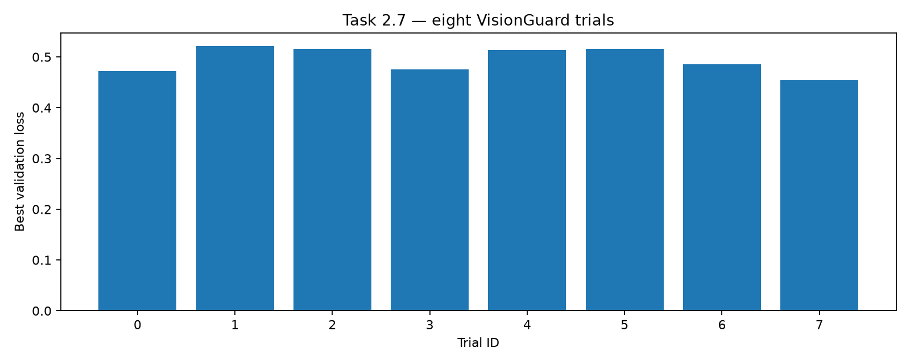

Figure: minimum validation loss in each VisionGuard trial. The largest range in
mean validation loss across tested settings was for **learning_rate**
(0.04468). Group means:
`{'1e-05': 0.5167778581380844, '0.0001': 0.4720950871706009}`. This is descriptive evidence from one small grid,
not a causal importance ranking; parameter interactions and augmentation noise remain.

Repeated model, epoch and threshold choices can overfit the same validation set.
The locked test set provides a final comparison; its results must not be used to
choose another threshold or configuration. No claim of universal performance on
new image generators or real-world image sources is supported by this split.

## Troubleshooting and remaining work

The original CNN run completed, then the official weight download failed with a
DNS error. Downloading the official weights and resuming preserved the completed
CNN rather than training it again. Logs for both attempts are in `logs/`.
The first three tuner attempts failed before training because TensorBoard was
missing. Its dependency was installed, failed tuner state was retained separately,
and a fresh eight-trial search was run. Failed attempts are not counted as trials.

Models are saved locally under `models/` and Git-ignored. `model_manifest.json`
records selected paths, sizes and SHA-256 hashes. DVC publication, MLflow/DagsHub
tracking, a serving application and the optional Grad-CAM bonus are not included.
Capture actual terminal screenshots with username, date and project context using
`python -m task2.show_results`; the PNG plots are figures, not terminal screenshots.

AI assistance was used to implement, test, execute and document this Task 2 work.
